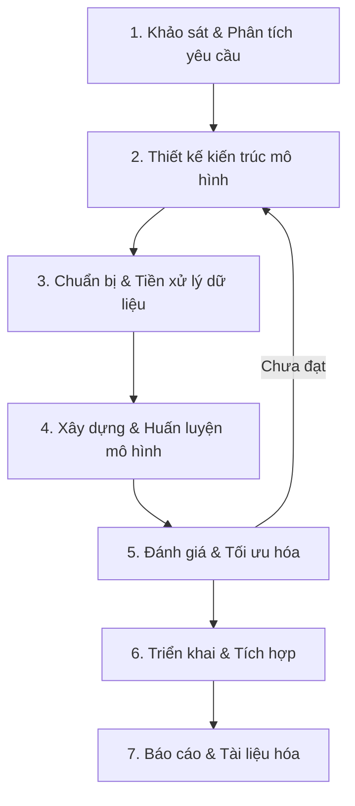

# 🧠 FashionMNIST - Deep Learning Image Classification

## Mô tả dự án

Dự án xây dựng mô hình **Deep Learning** để phân loại hình ảnh thời trang từ bộ dữ liệu **FashionMNIST**. Bộ dữ liệu bao gồm 70.000 ảnh grayscale 28×28 pixel thuộc 10 nhóm sản phẩm thời trang.

### 10 nhóm phân loại

| Label | Tên lớp         | Mô tả                |
|-------|------------------|-----------------------|
| 0     | T-shirt/top      | Áo phông / Áo trên   |
| 1     | Trouser          | Quần dài              |
| 2     | Pullover         | Áo len chui đầu      |
| 3     | Dress            | Đầm / Váy            |
| 4     | Coat             | Áo khoác              |
| 5     | Sandal           | Dép xăng-đan          |
| 6     | Shirt            | Áo sơ mi              |
| 7     | Sneaker          | Giày thể thao         |
| 8     | Bag              | Túi xách              |
| 9     | Ankle boot       | Bốt cổ ngắn           |

---

## 🔄 Quy trình làm việc (AI Coding Workflow)

Dự án tuân theo quy trình **AI-Assisted Coding Workflow** gồm 7 giai đoạn chính:



---

### Giai đoạn 1: Khảo sát & Phân tích yêu cầu 📋

**Mục tiêu:** Hiểu rõ bài toán, xác định phạm vi dự án.

| Bước | Công việc | Công cụ / AI hỗ trợ |
|------|-----------|----------------------|
| 1.1 | Tìm hiểu bộ dữ liệu FashionMNIST (cấu trúc, kích thước, phân phối lớp) | AI Research, Google Scholar |
| 1.2 | Xác định mục tiêu accuracy cần đạt (>90%) | Tham khảo benchmark |
| 1.3 | Xác định ràng buộc kỹ thuật (GPU, thời gian huấn luyện, framework) | Team discussion |
| 1.4 | Lập kế hoạch timeline và phân chia sprint | AI Planning Assistant |

**Output:** Tài liệu yêu cầu dự án (Project Requirements Document)

---

### Giai đoạn 2: Thiết kế kiến trúc mô hình 🏗️

**Mục tiêu:** Thiết kế kiến trúc mạng neural phù hợp.

| Bước | Công việc | Công cụ / AI hỗ trợ |
|------|-----------|----------------------|
| 2.1 | Nghiên cứu các kiến trúc phù hợp (CNN, ResNet, VGG...) | AI Code Assistant, Papers |
| 2.2 | Thiết kế sơ đồ kiến trúc mạng | AI Diagram Generator |
| 2.3 | Xác định hyperparameters ban đầu (learning rate, batch size, epochs...) | AI Suggestion |
| 2.4 | Thiết kế pipeline huấn luyện và đánh giá | AI Code Generation |
| 2.5 | Review thiết kế với team | Code Review |

**Output:** Architecture Design Document, Sơ đồ kiến trúc mạng

---

### Giai đoạn 3: Chuẩn bị & Tiền xử lý dữ liệu 📊

**Mục tiêu:** Chuẩn bị dữ liệu sạch, sẵn sàng cho huấn luyện.

| Bước | Công việc | Công cụ / AI hỗ trợ |
|------|-----------|----------------------|
| 3.1 | Tải và giải nén bộ dữ liệu FashionMNIST | `torchvision.datasets` |
| 3.2 | Phân tích thống kê dữ liệu (EDA - Exploratory Data Analysis) | AI Data Analysis |
| 3.3 | Chuẩn hóa dữ liệu (Normalization: mean, std) | PyTorch Transforms |
| 3.4 | Data Augmentation (flip, rotate, crop...) | `torchvision.transforms` |
| 3.5 | Chia tập train/validation/test | `torch.utils.data` |
| 3.6 | Tạo DataLoader với batch processing | PyTorch DataLoader |

**Output:** DataLoader objects, EDA Report, Data Pipeline

```python
# Ví dụ cấu hình transform
transform = transforms.Compose([
    transforms.RandomHorizontalFlip(),
    transforms.RandomRotation(10),
    transforms.ToTensor(),
    transforms.Normalize((0.2860,), (0.3530,))
])
```

---

### Giai đoạn 4: Xây dựng & Huấn luyện mô hình 🔧

**Mục tiêu:** Implement và train mô hình deep learning.

| Bước | Công việc | Công cụ / AI hỗ trợ |
|------|-----------|----------------------|
| 4.1 | Implement kiến trúc model bằng PyTorch | AI Code Generation |
| 4.2 | Cấu hình Loss Function (CrossEntropyLoss) | AI Suggestion |
| 4.3 | Cấu hình Optimizer (Adam, SGD...) | AI Hyperparameter Tuning |
| 4.4 | Implement Training Loop | AI Code Assistant |
| 4.5 | Implement Validation Loop | AI Code Assistant |
| 4.6 | Logging & Monitoring (TensorBoard, W&B) | AI Integration |
| 4.7 | Checkpoint saving & Early stopping | AI Best Practices |

**Output:** Trained Model, Training Logs, Checkpoints

```
📁 Cấu trúc thư mục huấn luyện
├── models/
│   ├── cnn_model.py
│   ├── resnet_model.py
│   └── best_model.pth
├── training/
│   ├── train.py
│   ├── config.yaml
│   └── logs/
└── checkpoints/
    └── epoch_*.pth
```

---

### Giai đoạn 5: Đánh giá & Tối ưu hóa 📈

**Mục tiêu:** Đánh giá hiệu suất và cải thiện mô hình.

| Bước | Công việc | Công cụ / AI hỗ trợ |
|------|-----------|----------------------|
| 5.1 | Đánh giá trên tập test (Accuracy, Precision, Recall, F1-score) | `sklearn.metrics` |
| 5.2 | Vẽ Confusion Matrix | AI Visualization |
| 5.3 | Phân tích lỗi (Error Analysis) - xem mẫu bị phân loại sai | AI Analysis |
| 5.4 | Hyperparameter Tuning (Grid Search, Optuna) | AI Optimization |
| 5.5 | Thử nghiệm các kỹ thuật regularization (Dropout, BatchNorm, L2) | AI Suggestion |
| 5.6 | Model Ensemble (nếu cần) | AI Architecture |
| 5.7 | So sánh kết quả giữa các model | AI Report Generation |

**Output:** Evaluation Report, Optimized Model, Comparison Charts

---

### Giai đoạn 6: Triển khai & Tích hợp 🚀

**Mục tiêu:** Đưa mô hình vào sử dụng thực tế.

| Bước | Công việc | Công cụ / AI hỗ trợ |
|------|-----------|----------------------|
| 6.1 | Export model (ONNX, TorchScript) | AI Conversion |
| 6.2 | Xây dựng API inference (FastAPI/Flask) | AI Code Generation |
| 6.3 | Xây dựng giao diện demo (Gradio/Streamlit) | AI UI Generation |
| 6.4 | Containerize ứng dụng (Docker) | AI DevOps |
| 6.5 | Viết unit test & integration test | AI Test Generation |
| 6.6 | Deploy lên server/cloud | AI Deployment |

**Output:** API Service, Demo UI, Docker Image, Test Suite

---

### Giai đoạn 7: Báo cáo & Tài liệu hóa 📝

**Mục tiêu:** Tổng hợp kết quả và hoàn thiện tài liệu.

| Bước | Công việc | Công cụ / AI hỗ trợ |
|------|-----------|----------------------|
| 7.1 | Viết báo cáo kỹ thuật (Technical Report) | AI Writing Assistant |
| 7.2 | Chuẩn bị slide thuyết trình | AI Presentation |
| 7.3 | Viết tài liệu hướng dẫn sử dụng (User Guide) | AI Documentation |
| 7.4 | Cập nhật README và API docs | AI Documentation |
| 7.5 | Chuẩn bị demo trình bày | Team Practice |

**Output:** Technical Report, Presentation Slides, Documentation

---

## 🛠️ Công nghệ sử dụng

| Công nghệ | Mục đích |
|------------|----------|
| **Python 3.10+** | Ngôn ngữ lập trình chính |
| **PyTorch** | Framework Deep Learning |
| **torchvision** | Dataset & Transforms |
| **NumPy / Pandas** | Xử lý dữ liệu |
| **Matplotlib / Seaborn** | Trực quan hóa |
| **scikit-learn** | Metrics đánh giá |
| **TensorBoard / W&B** | Monitoring |
| **Gradio / Streamlit** | Demo UI |
| **FastAPI** | API Service |
| **Docker** | Containerization |
| **Git / GitHub** | Version Control |
| **AI Coding Assistant** | Hỗ trợ viết code |

---

## 📂 Cấu trúc dự án (đề xuất)

```
FashionMNIST/
├── README.md                    # Tài liệu mô tả dự án
├── TEAM_ASSIGNMENT.md           # Phân công công việc nhóm
├── requirements.txt             # Dependencies
├── config/
│   └── config.yaml              # Cấu hình huấn luyện
├── data/
│   ├── raw/                     # Dữ liệu gốc
│   └── processed/               # Dữ liệu đã xử lý
├── notebooks/
│   ├── 01_EDA.ipynb             # Phân tích dữ liệu
│   ├── 02_Training.ipynb        # Huấn luyện mô hình
│   └── 03_Evaluation.ipynb      # Đánh giá mô hình
├── src/
│   ├── data/
│   │   ├── dataset.py           # Custom Dataset
│   │   └── transforms.py        # Data Augmentation
│   ├── models/
│   │   ├── cnn.py               # CNN Model
│   │   └── resnet.py            # ResNet Model
│   ├── training/
│   │   ├── trainer.py           # Training Loop
│   │   └── utils.py             # Helper functions
│   └── evaluation/
│       ├── evaluate.py          # Evaluation metrics
│       └── visualize.py         # Visualization
├── api/
│   ├── app.py                   # FastAPI application
│   └── Dockerfile               # Container config
├── tests/
│   ├── test_model.py            # Unit tests
│   └── test_api.py              # API tests
├── reports/
│   ├── figures/                 # Charts & Plots
│   └── technical_report.pdf     # Báo cáo kỹ thuật
└── checkpoints/
    └── best_model.pth           # Best trained model
```

---

## 🚀 Cách chạy dự án

```bash
# 1. Clone repository
git clone <repo-url>
cd FashionMNIST

# 2. Tạo virtual environment
python -m venv venv
source venv/bin/activate  # Linux/Mac
venv\Scripts\activate     # Windows

# 3. Cài đặt dependencies
pip install -r requirements.txt

# 4. Huấn luyện mô hình
python src/training/trainer.py --config config/config.yaml

# 5. Đánh giá mô hình
python src/evaluation/evaluate.py --model checkpoints/best_model.pth

# 6. Chạy API
uvicorn api.app:app --reload

# 7. Chạy Demo UI
python demo/app.py
```

---

## 📊 Kết quả mong đợi

| Metric    | Mục tiêu  |
|-----------|-----------|
| Accuracy  | > 92%     |
| F1-Score  | > 0.90    |
| Inference | < 10ms    |

---

## 👥 Thành viên nhóm

| STT | Họ tên | Vai trò |
|-----|--------|---------|
| 1   | Thiện  | Team Lead / Model Architect |
| 2   | Bảo    | Data Engineer |
| 3   | Bình   | Model Developer |
| 4   | Khoa   | Evaluation & Optimization |
| 5   | Việt   | Deployment & API |
| 6   | Hưng   | Documentation & Testing |

> Chi tiết phân công xem tại [TEAM_ASSIGNMENT.md](./TEAM_ASSIGNMENT.md)

