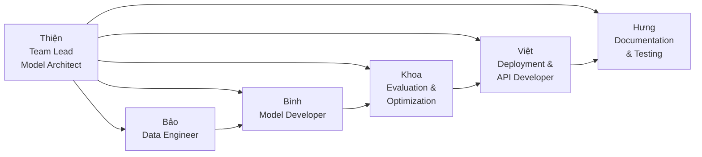
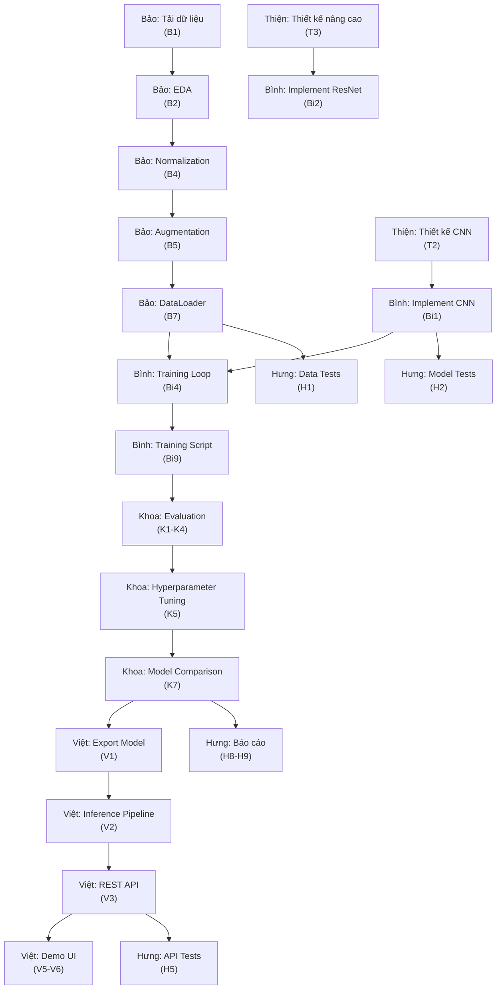

# 👥 Phân công công việc nhóm - FashionMNIST Project

## Thông tin chung

| Thông tin | Chi tiết |
|-----------|----------|
| **Dự án** | FashionMNIST - Deep Learning Image Classification |
| **Số thành viên** | 6 người |
| **Framework** | PyTorch |
| **Ngày bắt đầu** | 04/11/2026 |

---

## 📋 Tổng quan phân công

---

## 1️⃣ Thiện — Team Lead / Model Architect

### Vai trò chính
Quản lý dự án tổng thể, thiết kế kiến trúc mô hình, điều phối công việc giữa các thành viên, và review code.

### Danh sách công việc chi tiết

| # | Công việc | Mô tả chi tiết | File/Output | Deadline | Trạng thái |
|---|-----------|----------------|-------------|----------|------------|
| T1 | **Lập kế hoạch dự án** | Xác định timeline, milestones, chia sprint cho từng giai đoạn. Tạo Gantt chart hoặc Kanban board | `docs/project_plan.md` | Tuần 1 | ⬜ |
| T2 | **Thiết kế kiến trúc CNN** | Thiết kế kiến trúc mạng CNN chính: số lớp Conv, kích thước kernel, stride, padding, pooling, FC layers. Vẽ sơ đồ kiến trúc | `docs/architecture.md`, `src/models/cnn.py` | Tuần 1-2 | ⬜ |
| T3 | **Thiết kế kiến trúc nâng cao** | Thiết kế biến thể ResNet/VGG phù hợp FashionMNIST (ResNet-lite). Xác định skip connections, batch normalization | `src/models/resnet.py` | Tuần 2-3 | ⬜ |
| T4 | **Xác định Hyperparameters** | Chọn và document các hyperparameters: learning rate (0.001), batch size (64/128), epochs (50), optimizer (Adam), loss function (CrossEntropyLoss) | `config/config.yaml` | Tuần 1 | ⬜ |
| T5 | **Setup Git repository** | Khởi tạo repo, tạo `.gitignore`, thiết lập branching strategy (main/develop/feature), tạo PR template | `.gitignore`, `CONTRIBUTING.md` | Tuần 1 | ⬜ |
| T6 | **Code Review** | Review tất cả Pull Requests của các thành viên. Đảm bảo code quality, naming convention, docstring | PR comments | Hàng tuần | ⬜ |
| T7 | **Họp nhóm & báo cáo tiến độ** | Tổ chức standup hàng tuần, cập nhật tiến độ, giải quyết blockers | Meeting notes | Hàng tuần | ⬜ |
| T8 | **Tích hợp các module** | Ghép nối các module từ các thành viên thành pipeline hoàn chỉnh: data → model → train → evaluate | `main.py` | Tuần 5 | ⬜ |
| T9 | **Tạo file `requirements.txt`** | Liệt kê tất cả dependencies với version cụ thể: `torch>=2.0`, `torchvision`, `numpy`, `matplotlib`, `scikit-learn`... | `requirements.txt` | Tuần 1 | ⬜ |
| T10 | **Quản lý cấu trúc thư mục** | Tạo và duy trì cấu trúc thư mục chuẩn cho dự án | Folder structure | Tuần 1 | ⬜ |

### Kỹ năng yêu cầu
- Project Management
- Deep Learning Architecture Design
- PyTorch Advanced
- Git/GitHub workflow
- Code Review

---

## 2️⃣ Bảo — Data Engineer

### Vai trò chính
Chịu trách nhiệm toàn bộ pipeline dữ liệu: tải, phân tích, tiền xử lý, augmentation, và tạo DataLoader.

### Danh sách công việc chi tiết

| # | Công việc | Mô tả chi tiết | File/Output | Deadline | Trạng thái |
|---|-----------|----------------|-------------|----------|------------|
| B1 | **Tải & tổ chức dữ liệu** | Download FashionMNIST qua `torchvision.datasets`. Tổ chức vào thư mục `data/raw/`. Kiểm tra tính toàn vẹn dữ liệu (60,000 train + 10,000 test) | `data/raw/`, `src/data/download.py` | Tuần 1 | ⬜ |
| B2 | **Phân tích dữ liệu (EDA)** | Viết notebook phân tích: phân phối các lớp, hiển thị mẫu từng lớp, tính mean/std, phát hiện class imbalance, phân tích pixel distribution | `notebooks/01_EDA.ipynb` | Tuần 1-2 | ⬜ |
| B3 | **Trực quan hóa dữ liệu** | Vẽ grid ảnh mẫu (5×10 grid cho 10 classes), histogram phân phối nhãn, heatmap giá trị pixel trung bình mỗi class | `reports/figures/data_visualization.png` | Tuần 2 | ⬜ |
| B4 | **Tính toán Normalization** | Tính chính xác mean và std của toàn bộ training set để chuẩn hóa. Document công thức và giá trị | `docs/data_stats.md` | Tuần 2 | ⬜ |
| B5 | **Implement Data Augmentation** | Code các transform pipeline: `RandomHorizontalFlip(p=0.5)`, `RandomRotation(10)`, `RandomAffine(degrees=0, translate=(0.1,0.1))`, `ColorJitter`. Tạo 2 pipeline: train (có augment) và test (chỉ normalize) | `src/data/transforms.py` | Tuần 2-3 | ⬜ |
| B6 | **Tạo Custom Dataset class** | Viết class kế thừa `torch.utils.data.Dataset` với `__len__`, `__getitem__`. Hỗ trợ caching, lazy loading | `src/data/dataset.py` | Tuần 2 | ⬜ |
| B7 | **Tạo DataLoader** | Cấu hình DataLoader: batch_size, shuffle, num_workers, pin_memory, drop_last. Tạo hàm `get_dataloaders()` trả về train/val/test loader | `src/data/dataloader.py` | Tuần 2-3 | ⬜ |
| B8 | **Chia tập Validation** | Tách 10-20% từ training set làm validation set. Sử dụng `torch.utils.data.random_split` hoặc stratified split để đảm bảo cân bằng class | `src/data/split.py` | Tuần 2 | ⬜ |
| B9 | **Kiểm tra Data Pipeline** | Viết script test kiểm tra output của DataLoader: shape đúng `(B, 1, 28, 28)`, labels trong `[0,9]`, giá trị pixel đã normalize | `tests/test_data.py` | Tuần 3 | ⬜ |
| B10 | **Document Data Pipeline** | Viết tài liệu mô tả chi tiết data pipeline, các transform áp dụng, lý do chọn | `docs/data_pipeline.md` | Tuần 3 | ⬜ |

### Kỹ năng yêu cầu
- Python Data Processing (NumPy, Pandas)
- PyTorch Dataset & DataLoader
- Data Visualization (Matplotlib, Seaborn)
- Exploratory Data Analysis (EDA)
- Data Augmentation techniques

---

## 3️⃣ Bình — Model Developer

### Vai trò chính
Implement các mô hình deep learning, viết training loop, quản lý quá trình huấn luyện.

### Danh sách công việc chi tiết

| # | Công việc | Mô tả chi tiết | File/Output | Deadline | Trạng thái |
|---|-----------|----------------|-------------|----------|------------|
| Bi1 | **Implement CNN cơ bản** | Code mạng CNN theo thiết kế của Thiện: Conv2d → ReLU → MaxPool → Conv2d → ReLU → MaxPool → Flatten → FC → FC. Thêm Dropout, BatchNorm | `src/models/cnn.py` | Tuần 2-3 | ⬜ |
| Bi2 | **Implement mô hình nâng cao** | Code biến thể ResNet/VGG-lite theo thiết kế: residual blocks, skip connections. Hỗ trợ cấu hình số lớp linh hoạt | `src/models/resnet.py` | Tuần 3-4 | ⬜ |
| Bi3 | **Tạo Model Factory** | Viết hàm `create_model(model_name, **kwargs)` để tạo model theo tên. Hỗ trợ registry pattern | `src/models/__init__.py` | Tuần 3 | ⬜ |
| Bi4 | **Implement Training Loop** | Viết class `Trainer` với các method: `train_one_epoch()`, `validate()`, `fit()`. Hỗ trợ: gradient clipping, mixed precision (AMP), progress bar (tqdm) | `src/training/trainer.py` | Tuần 3-4 | ⬜ |
| Bi5 | **Implement Learning Rate Scheduler** | Thêm LR scheduler: `StepLR`, `CosineAnnealingLR`, `ReduceLROnPlateau`. Cho phép chọn qua config | `src/training/scheduler.py` | Tuần 3 | ⬜ |
| Bi6 | **Implement Early Stopping** | Code class `EarlyStopping` với patience, delta. Monitor validation loss hoặc accuracy | `src/training/early_stopping.py` | Tuần 3 | ⬜ |
| Bi7 | **Checkpoint Management** | Implement save/load checkpoint: model weights, optimizer state, epoch, best metric. Hàm `save_checkpoint()` và `load_checkpoint()` | `src/training/checkpoint.py` | Tuần 3-4 | ⬜ |
| Bi8 | **Logging & Monitoring** | Tích hợp TensorBoard/Weights & Biases: log loss, accuracy, learning rate, model graph, sample predictions mỗi epoch | `src/training/logger.py` | Tuần 4 | ⬜ |
| Bi9 | **Viết Training Script** | Script chính để huấn luyện: parse config, tạo model, load data, train, save best model. Hỗ trợ resume training từ checkpoint | `train.py` | Tuần 4 | ⬜ |
| Bi10 | **Training Notebook** | Viết notebook demo quá trình training với visualization: loss curve, accuracy curve, learning rate schedule | `notebooks/02_Training.ipynb` | Tuần 4-5 | ⬜ |
| Bi11 | **In ra Model Summary** | Viết hàm in tóm tắt model: số parameters, kích thước mỗi layer, tổng trainable params, model size (MB) | `src/models/summary.py` | Tuần 3 | ⬜ |

### Kỹ năng yêu cầu
- PyTorch nn.Module, Optimizer, Loss
- Training Loop design patterns
- Mixed Precision Training
- TensorBoard / W&B
- OOP Python

---

## 4️⃣ Khoa — Evaluation & Optimization

### Vai trò chính
Đánh giá hiệu suất mô hình, phân tích lỗi, tối ưu hyperparameters, và cải thiện model performance.

### Danh sách công việc chi tiết

| # | Công việc | Mô tả chi tiết | File/Output | Deadline | Trạng thái |
|---|-----------|----------------|-------------|----------|------------|
| K1 | **Implement Evaluation Metrics** | Code các hàm tính: Accuracy, Precision, Recall, F1-Score (macro/micro/weighted), Top-k Accuracy. Hỗ trợ per-class và overall metrics | `src/evaluation/metrics.py` | Tuần 4 | ⬜ |
| K2 | **Vẽ Confusion Matrix** | Tạo hàm vẽ confusion matrix đẹp: heatmap với annotations, normalized version, có tên class thay vì số | `src/evaluation/confusion_matrix.py` | Tuần 4 | ⬜ |
| K3 | **Classification Report** | Sinh báo cáo chi tiết: precision/recall/f1 từng class, support count, macro/weighted average. Xuất dạng bảng và JSON | `src/evaluation/report.py` | Tuần 4-5 | ⬜ |
| K4 | **Error Analysis** | Phân tích các mẫu bị phân loại sai: hiển thị ảnh, true label vs predicted label, confidence score. Tìm pattern lỗi phổ biến (ví dụ: Shirt ↔ T-shirt, Pullover ↔ Coat) | `src/evaluation/error_analysis.py` | Tuần 5 | ⬜ |
| K5 | **Hyperparameter Tuning** | Implement Grid Search hoặc sử dụng Optuna để tìm hyperparams tốt nhất: learning rate, batch size, dropout rate, weight decay, optimizer type | `src/optimization/hparam_search.py` | Tuần 5-6 | ⬜ |
| K6 | **Regularization Experiments** | Thử nghiệm và so sánh các kỹ thuật: Dropout (0.25, 0.5), L2 Regularization, Label Smoothing, Data Augmentation mạnh hơn | `notebooks/04_Regularization.ipynb` | Tuần 5 | ⬜ |
| K7 | **Model Comparison** | So sánh hiệu suất các model (CNN vs ResNet vs VGG): accuracy, training time, model size, inference speed. Tạo bảng và biểu đồ so sánh | `reports/model_comparison.md` | Tuần 6 | ⬜ |
| K8 | **ROC Curve & AUC** | Vẽ ROC curve cho từng class (One-vs-Rest), tính AUC score. Vẽ cả micro/macro average ROC | `src/evaluation/roc_curve.py` | Tuần 5 | ⬜ |
| K9 | **Visualization mẫu dự đoán** | Tạo grid hiển thị predictions: ảnh + true label + predicted label + confidence. Đánh dấu màu đỏ cho sai, xanh cho đúng | `src/evaluation/visualize_predictions.py` | Tuần 5 | ⬜ |
| K10 | **Evaluation Notebook** | Notebook tổng hợp toàn bộ kết quả đánh giá, biểu đồ, phân tích | `notebooks/03_Evaluation.ipynb` | Tuần 6 | ⬜ |
| K11 | **Viết báo cáo kết quả** | Document kết quả thí nghiệm, so sánh, kết luận model tốt nhất và lý do | `reports/evaluation_report.md` | Tuần 6 | ⬜ |

### Kỹ năng yêu cầu
- sklearn.metrics (classification_report, confusion_matrix)
- Data Visualization (Matplotlib, Seaborn)
- Hyperparameter Optimization (Optuna)
- Statistical Analysis
- Experiment tracking

---

## 5️⃣ Việt — Deployment & API Developer

### Vai trò chính
Triển khai mô hình thành API service, xây dựng giao diện demo, đóng gói và deploy ứng dụng.

### Danh sách công việc chi tiết

| # | Công việc | Mô tả chi tiết | File/Output | Deadline | Trạng thái |
|---|-----------|----------------|-------------|----------|------------|
| V1 | **Export Model** | Chuyển đổi model sang các format phục vụ inference: TorchScript (`torch.jit.trace`), ONNX (`torch.onnx.export`). So sánh inference speed giữa các format | `src/deployment/export.py` | Tuần 5 | ⬜ |
| V2 | **Xây dựng Inference Pipeline** | Code class `Predictor`: load model, preprocess input image, predict, postprocess (class name + confidence). Hỗ trợ batch inference | `src/deployment/predictor.py` | Tuần 5 | ⬜ |
| V3 | **Xây dựng REST API (FastAPI)** | Tạo API endpoints: `POST /predict` (upload ảnh → prediction), `GET /health` (health check), `GET /classes` (danh sách classes). Thêm input validation, error handling | `api/app.py` | Tuần 5-6 | ⬜ |
| V4 | **API Request/Response Schema** | Định nghĩa Pydantic models cho request/response: `PredictionRequest`, `PredictionResponse` (class_name, confidence, probabilities). Swagger documentation | `api/schemas.py` | Tuần 5 | ⬜ |
| V5 | **Xây dựng Demo UI (Gradio)** | Tạo giao diện web demo: upload ảnh → hiển thị prediction + confidence bar chart cho 10 classes. Thêm example images | `demo/gradio_app.py` | Tuần 6 | ⬜ |
| V6 | **Xây dựng Demo UI (Streamlit)** | Tạo dashboard Streamlit: upload ảnh, camera capture, batch prediction, hiển thị statistics | `demo/streamlit_app.py` | Tuần 6 | ⬜ |
| V7 | **Viết Dockerfile** | Tạo multi-stage Dockerfile: build stage (install deps) → runtime stage (copy model + app). Optimize image size. Viết `.dockerignore` | `Dockerfile`, `.dockerignore` | Tuần 6 | ⬜ |
| V8 | **Docker Compose** | Cấu hình docker-compose cho full stack: API server + demo UI. Bind volumes cho model weights | `docker-compose.yml` | Tuần 6 | ⬜ |
| V9 | **API Performance Testing** | Benchmark API: đo latency (p50, p95, p99), throughput (requests/sec), memory usage. Sử dụng `locust` hoặc `wrk` | `tests/load_test.py` | Tuần 6-7 | ⬜ |
| V10 | **Viết hướng dẫn deploy** | Document hướng dẫn deploy: local, Docker, cloud (GCP/AWS). Bao gồm environment setup, cấu hình | `docs/deployment_guide.md` | Tuần 7 | ⬜ |

### Kỹ năng yêu cầu
- FastAPI / Flask
- Docker & Docker Compose
- Gradio / Streamlit
- Model Serving (TorchScript, ONNX)
- REST API Design
- Load Testing

---

## 6️⃣ Hưng — Documentation & Testing

### Vai trò chính
Đảm bảo chất lượng code bằng testing, viết tài liệu hoàn chỉnh, chuẩn bị báo cáo và thuyết trình.

### Danh sách công việc chi tiết

| # | Công việc | Mô tả chi tiết | File/Output | Deadline | Trạng thái |
|---|-----------|----------------|-------------|----------|------------|
| H1 | **Viết Unit Tests cho Data Module** | Test các hàm trong data pipeline: transform output shape, dataset length, dataloader batch shape, normalization values | `tests/test_data.py` | Tuần 3-4 | ⬜ |
| H2 | **Viết Unit Tests cho Models** | Test model: output shape đúng `(B, 10)`, forward pass không lỗi, parameter count đúng, gradient flow | `tests/test_models.py` | Tuần 4 | ⬜ |
| H3 | **Viết Unit Tests cho Training** | Test training utilities: checkpoint save/load, early stopping logic, metric calculation, lr scheduler step | `tests/test_training.py` | Tuần 4-5 | ⬜ |
| H4 | **Viết Integration Tests** | Test end-to-end pipeline: load data → create model → train 1 epoch → evaluate → save model. Đảm bảo pipeline không break | `tests/test_integration.py` | Tuần 5 | ⬜ |
| H5 | **Viết API Tests** | Test API endpoints: correct response status, response schema, invalid input handling, edge cases (wrong image format, large file) | `tests/test_api.py` | Tuần 6 | ⬜ |
| H6 | **Setup CI/CD (GitHub Actions)** | Cấu hình CI pipeline: auto run tests on PR, lint check (flake8/black), type check (mypy). Badge hiển thị test status | `.github/workflows/ci.yml` | Tuần 3 | ⬜ |
| H7 | **Code Quality Tools** | Setup và cấu hình: `black` (formatting), `isort` (import sorting), `flake8` (linting), `mypy` (type checking). Tạo config files | `pyproject.toml`, `.flake8` | Tuần 2 | ⬜ |
| H8 | **Viết báo cáo kỹ thuật** | Viết Technical Report hoàn chỉnh: giới thiệu, phương pháp, kiến trúc model, kết quả thí nghiệm, kết luận. Format LaTeX hoặc Word | `reports/technical_report.pdf` | Tuần 7 | ⬜ |
| H9 | **Chuẩn bị slide thuyết trình** | Tạo slide (PowerPoint/Google Slides): 15-20 slides bao gồm: bài toán, dataset, phương pháp, kiến trúc, kết quả, demo, kết luận | `reports/presentation.pptx` | Tuần 7 | ⬜ |
| H10 | **Viết Docstrings & Comments** | Review và bổ sung docstring cho tất cả function/class trong project. Theo chuẩn Google docstring style | Tất cả file `.py` | Liên tục | ⬜ |
| H11 | **Viết User Guide** | Tài liệu hướng dẫn sử dụng cho end-user: cách cài đặt, chạy training, sử dụng API, chạy demo | `docs/user_guide.md` | Tuần 7 | ⬜ |
| H12 | **Tạo API Documentation** | Viết docs cho API: endpoints, request/response format, error codes, ví dụ curl/Python. Kết hợp Swagger UI | `docs/api_docs.md` | Tuần 6-7 | ⬜ |

### Kỹ năng yêu cầu
- pytest, unittest
- CI/CD (GitHub Actions)
- Technical Writing
- Code Quality Tools (black, flake8, mypy)
- Documentation (Markdown, LaTeX)

---

## 📅 Timeline tổng thể

| Tuần | Giai đoạn | Thiện | Bảo | Bình | Khoa | Việt | Hưng |
|------|-----------|-------|-----|------|------|------|------|
| **1** | Khởi động | T1,T4,T5,T9,T10 | B1,B2 | — | — | — | H7 |
| **2** | Dữ liệu | T2 | B2,B3,B4,B5,B6,B8 | — | — | — | H7 |
| **3** | Model + Data | T3,T6 | B5,B7,B9,B10 | Bi1,Bi3,Bi5,Bi6,Bi11 | — | — | H1,H6 |
| **4** | Training | T6 | — | Bi1,Bi2,Bi4,Bi7,Bi8 | K1,K2 | — | H1,H2,H3 |
| **5** | Eval + Deploy | T6,T8 | — | Bi2,Bi9,Bi10 | K3,K4,K5,K6,K8,K9 | V1,V2,V3,V4 | H3,H4 |
| **6** | Deploy + Optimize | T6 | — | Bi10 | K5,K6,K7,K10,K11 | V5,V6,V7,V8,V9 | H5,H6,H12 |
| **7** | Báo cáo | T7 | — | — | K11 | V10 | H8,H9,H10,H11 |

---

## 🔗 Phụ thuộc công việc giữa các thành viên

---

## 📌 Quy tắc làm việc nhóm

### Git Workflow
1. **Không push trực tiếp lên `main`** — Luôn tạo Pull Request
2. **Đặt tên branch**: `feature/<tên-thành-viên>/<mô-tả>` (ví dụ: `feature/bao/data-pipeline`)
3. **Commit message**: Tuân theo Conventional Commits (`feat:`, `fix:`, `docs:`, `test:`)
4. **Mỗi PR cần ít nhất 1 review** từ Thiện (Team Lead)

### Code Standards
- **Format**: Sử dụng `black` với line-length=88
- **Docstring**: Google style docstring cho mọi function/class
- **Type hints**: Bắt buộc cho function parameters và return type
- **Naming**: snake_case cho functions/variables, PascalCase cho classes

### Communication
- **Standup**: Họp online hàng tuần (thời gian do Thiện sắp xếp)
- **Chat**: Group chat để trao đổi nhanh
- **Blockers**: Báo ngay khi gặp vấn đề, không đợi đến standup

### Đánh dấu trạng thái
| Icon | Trạng thái |
|------|-----------|
| ⬜ | Chưa bắt đầu |
| 🔄 | Đang thực hiện |
| 🔍 | Đang review |
| ✅ | Hoàn thành |
| ❌ | Bị block |

---

## 📞 Liên hệ hỗ trợ

| Vấn đề | Liên hệ |
|--------|---------|
| Git conflict, merge issues | Thiện |
| Data loading, preprocessing | Bảo |
| Model bug, training issues | Bình |
| Metric calculation, tuning | Khoa |
| API, deployment issues | Việt |
| Test failures, docs | Hưng |

---

> **Lưu ý**: Timeline và phân công có thể được điều chỉnh tùy theo tiến độ thực tế. Mọi thay đổi cần được thông qua Team Lead (Thiện).

